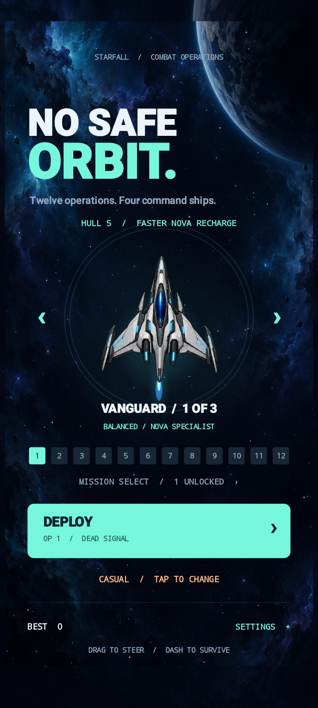
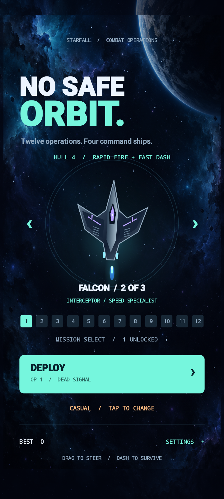
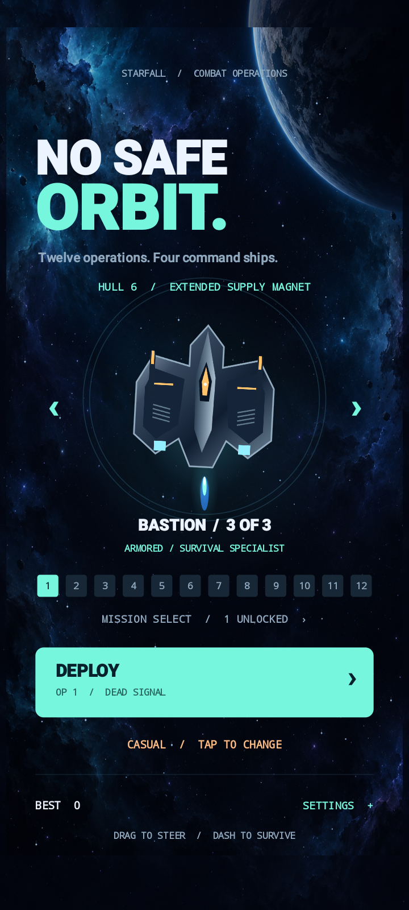
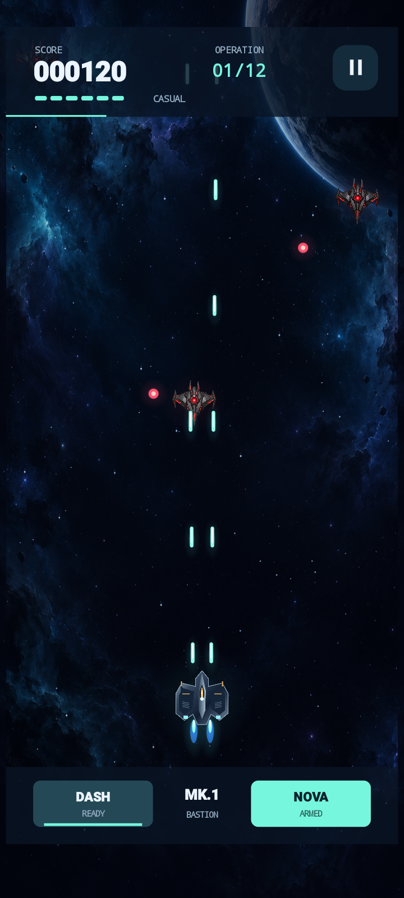
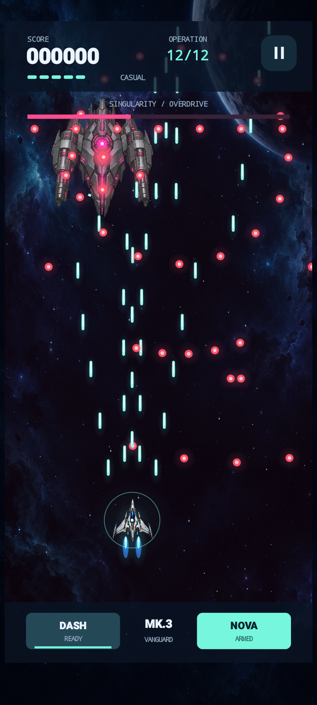
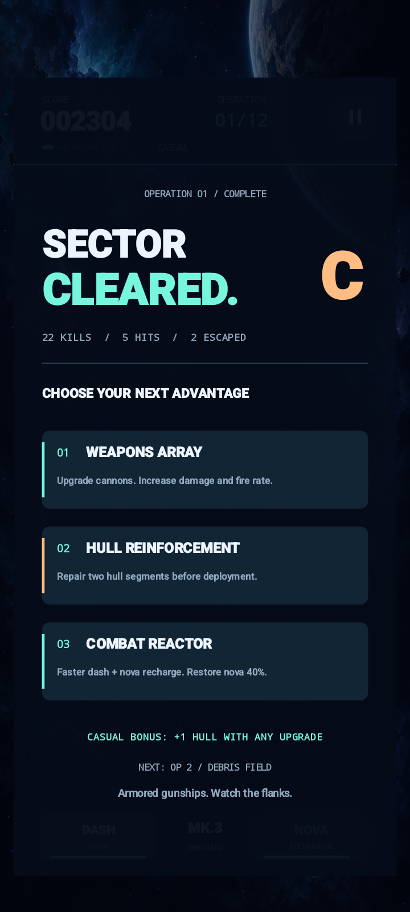

# STARFALL — No Safe Orbit

A native Android space shooter with **12 missions, four bosses and three playable
spaceships**. Drag to steer, fire automatically, dodge with a dash, and clear the
screen with Nova. Play offline with no ads, accounts or network permissions.

**Version 0.3.0:** Casual is the new default, with slower attacks, more hull, frequent
repairs and faster abilities. Standard, Veteran and Nightmare remain selectable.
Built with Java and Android's hardware Canvas, without Unity or a WebView.

## Screenshots

Real Android captures at 720 × 1600, shown smaller here. Tap an image to inspect it.

| Vanguard | Falcon | Bastion |
| :---: | :---: | :---: |
|  |  |  |
| **Casual combat** | **Singularity boss** | **Mission upgrades** |
|  |  |  |

The boss image uses an invulnerable test pilot to demonstrate the encounter.
The mission result comes from actual manual play with normal damage.
[More screens and capture details](docs/screenshots/v0.3.0/README.md) ·
[Testing results and limitations](docs/TESTING.md)

## Play on Android

Requires **Android 8.0 (API 26) or newer**. This repository contains source code;
the APK and installed development tools are excluded from Git.

- If the maintainer has published an APK, download it from
  [GitHub Releases](https://github.com/agamjotsingh08/StarFall/releases).
  A release is not automatically created by uploading the source.
- Open the APK on your Android device. If Android asks, allow installation from
  the browser or file manager you used. You can turn that permission off afterward.
- Launch **Starfall**. Start with **Casual + Vanguard**, or choose **Bastion** for
  extra hull health. Tap **Deploy**.
- If no APK release is available, follow the build instructions below.

For developers, `adb install -r app/build/outputs/apk/debug/app-debug.apk` installs
the debug build on a connected device. See [INSTALL.md](docs/INSTALL.md) for details,
emulator setup and troubleshooting.

## Choose your spaceship

All three ships are available immediately. Tap the left/right arrows around the
ship in the hangar. Selection is saved and applied when starting a new run.

| Ship | Casual starting hull | Specialty |
| --- | ---: | --- |
| Vanguard | 5 | Nova cooldown is 20% shorter |
| Falcon | 4 | Cannons fire 20% faster; dash cooldown is 25% shorter |
| Bastion | 6 | Extra hull; supply magnet reaches 155 instead of 105 arena units |

Falcon and Bastion have distinct original hull silhouettes. Combat uses the same
small cockpit hitbox for every ship, regardless of the hull's visual size.

## Controls and progression

- **Drag** in the arena to steer relative to your finger. Cannons fire automatically.
- **Dash** at bottom left moves in your last steering direction and briefly protects
  you. A second finger can activate it while you steer.
- **Nova** at bottom right clears hostile bullets and damages enemies.
- Collect **W** to upgrade cannons and **+** to repair hull. Nearby supplies are
  pulled toward your ship. Near misses award points and recharge Nova.
- After each mission, choose stronger weapons, hull repairs/reinforcement, or faster
  ability recharge. Casual also repairs one hull with any upgrade choice.
- Bosses guard missions 3, 6, 9 and 12. Cleared missions unlock the next one for replay.
- Tap the hangar difficulty label to cycle **Casual → Standard → Veteran → Nightmare**.
  Difficulty and ship stay fixed during a run.
- Pause at top right. Backgrounding the app pauses combat; resuming is explicit.
- Settings includes sound, three graphics presets, a frame counter and instructions.

Best score, mission unlocks, selected mission, ship and settings persist. A run in
progress is not saved across process termination; relaunching returns to the hangar.

## Build from source

### Requirements

- [Android Studio](https://developer.android.com/studio) and **JDK 21** for Gradle.
- Android SDK **Platform 35**, **Build Tools 35.0.0**, and **Platform Tools**.
- Internet access for the first Gradle/dependency download; gameplay itself is offline.
- The included Gradle **8.11.1** wrapper and Android Gradle Plugin **8.9.2** handle the build.
  You do not need a separate Gradle installation.

### Android Studio

1. Clone the repository once its source is uploaded, or extract its source ZIP:

   ```sh
   git clone https://github.com/agamjotsingh08/StarFall.git
   cd StarFall
   ```

2. Open the project root (the folder containing `settings.gradle`) in Android Studio.
3. In **SDK Manager**, install the SDK components above. Let Studio create
   `local.properties` with your SDK location; that machine-specific file stays out of Git.
4. Under **Settings → Build, Execution, Deployment → Build Tools → Gradle**, select
   **JDK 21** as the Gradle JDK. Do not assume Studio's bundled runtime is compatible
   with this project's pinned Gradle version.
5. Sync Gradle. Choose the **app** run configuration and an emulator or Android phone,
   then click **Run**.

### Command line

Set `JAVA_HOME` to JDK 21 and `ANDROID_HOME` to your Android SDK installation, or
provide `sdk.dir` in `local.properties`.

Windows PowerShell:

```powershell
.\gradlew.bat assembleDebug testDebugUnitTest lintDebug
# Optional convenience script: also copies the APK into dist/.
.\scripts\build.ps1
```

macOS / Linux:

```sh
sh ./gradlew assembleDebug testDebugUnitTest lintDebug
```

The APK is **`app/build/outputs/apk/debug/app-debug.apk`**. The Windows build script
also produces **`dist/starfall-debug.apk`**. The app's debug package is
`com.starfall.game.debug`; Android signs this development build with a local debug key.

Run device tests with one emulator or USB-debugging-enabled phone connected:

```powershell
.\gradlew.bat connectedDebugAndroidTest
```

On macOS/Linux, use `sh ./gradlew connectedDebugAndroidTest`. The current native
instrumentation suite targets API 29 or newer; the app itself supports API 26+.

### Capture interface screenshots

Build the app and test APK with `gradlew.bat assembleDebug assembleDebugAndroidTest`,
start an API 29+ emulator, then run:

```powershell
.\scripts\capture-screenshots.ps1 -Serial emulator-5554
```

This runs the native tests and saves original screenshots under
`docs/screenshots/v0.3.0/` only after the tests pass. It covers all three ships,
Casual combat, a boss encounter, pause, upgrades and victory. Boss/debrief/victory
screens use reproducible test scenarios; they are not claims of an unassisted run.
Inspect the captured files before using them in a release or README gallery.

## Repository guide

| Location | Purpose |
| --- | --- |
| `app/src/main/java/com/starfall/game/` | Simulation, rendering, audio and Android lifecycle |
| `app/src/main/res/` | Bundled artwork, audio and Android resources |
| `app/src/test/` | Deterministic gameplay tests |
| `app/src/androidTest/` | Native input, rendering, lifecycle and persistence tests |
| `scripts/` | Build helpers, campaign soak and difficulty probe |
| [Installation guide](docs/INSTALL.md) | APK installation, emulator and build troubleshooting |
| [Testing record](docs/TESTING.md) | Completed checks and device-coverage limits |
| [Every-level audit](docs/LEVEL-AUDIT.md) | Level matrix, boss phases, upgrade paths and stress checks |
| [Artwork](docs/ART.md) | Asset provenance |
| [Contributing](CONTRIBUTING.md) | Development and validation conventions |
| [Changelog](CHANGELOG.md) | Changes by version |

`GameWorld` runs a deterministic simulation at 120 fixed steps per second.
`GameView` requests 60 Hz presentation with Choreographer and hardware Canvas.
Gameplay objects and particles use separate preallocated pools; textures are loaded
once. `Campaign` owns difficulty tuning and `Fleet` defines ship perks. Quality
presets adjust visual effects without changing simulation rules.

## Local tooling and future distribution

Use your installed Android Studio and the standard setup instructions above.
Machine-specific launchers, environment files, SDKs, JDKs, caches, APKs, logs and
signing keys are excluded from Git. Only the reviewed 0.3.0 screenshot gallery is
included; historical and diagnostic captures remain local.

Source upload, APK release publication and Play Store distribution are separate steps.
See [the maintainer notes](docs/INSTALL.md#publishing-later) for preparing an APK release.
Release signing is not configured; the owner supplies and retains their signing key.
See [LICENSE-NOTES.md](LICENSE-NOTES.md) before redistributing or reusing source/assets.
